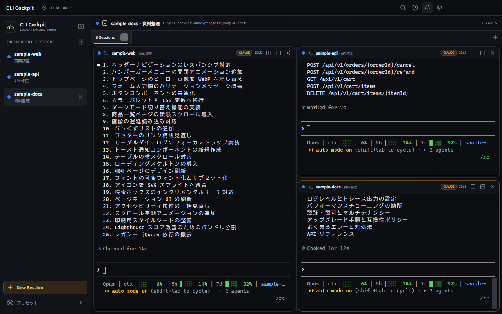
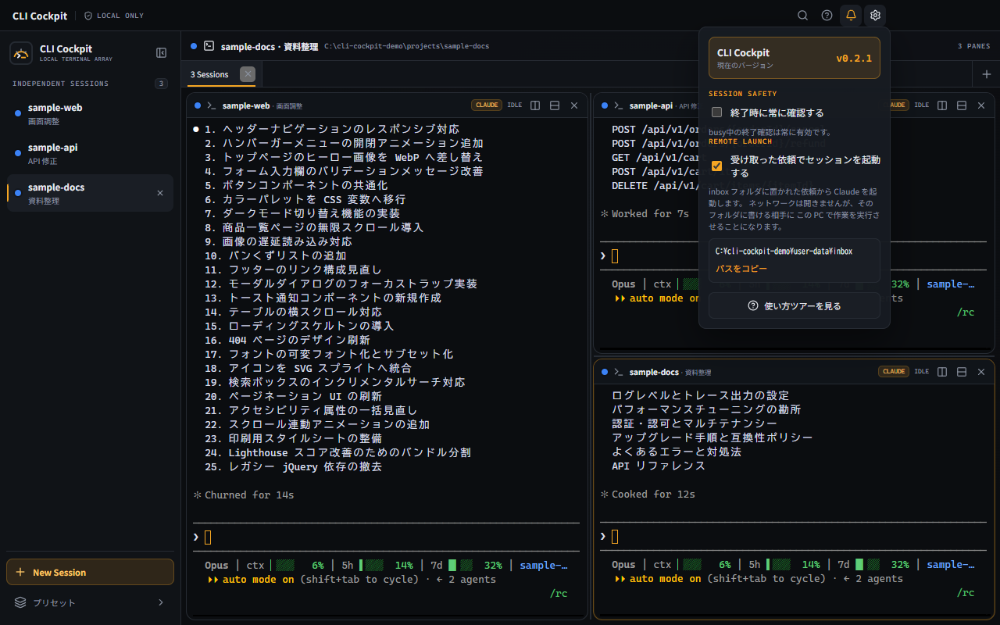
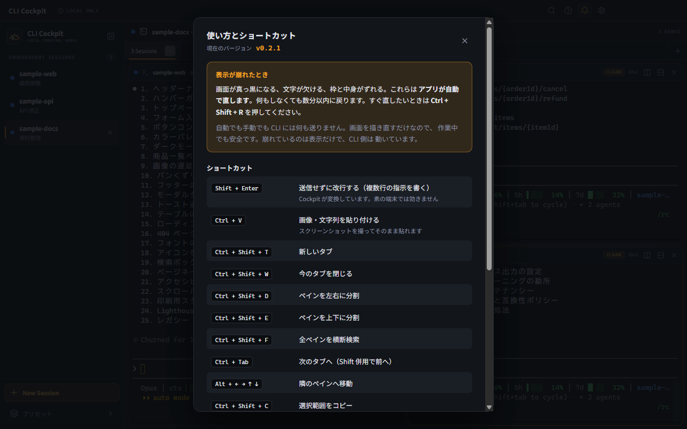

# AI Agent CLI Cockpit

日本語 · [English](https://github.com/quest-stack/ai-agent-cli-cockpit/blob/main/README.en.md)

Claude Code CLI と Codex CLI のセッションを、1つのウィンドウのタブとペインで
束ね、作ったものを隣のプレビューで確認できるデスクトップアプリです。

**Windows版（日本語・英語）と、Mac試用版（日本語）を無償で公開しています。**
[最新版をダウンロード](https://github.com/quest-stack/ai-agent-cli-cockpit/releases/latest) ·
[Windowsの導入](#windows版) · [Macの導入](#mac試用版) · [変更履歴](CHANGELOG.md)

複数の AI CLI を同時に走らせていると、ターミナルの窓が案件の数だけ増えます。
どれがどの案件か分からなくなり、承認待ちで止まっているセッションを見落とし、
窓を探すだけで時間が溶けます。それを1つの画面にまとめます。



自社の業務で使うために作ったものを、そのまま公開しています。

---

## 目次

- [Codexを携帯と共有する](docs/CODEX_REMOTE.md)
- [何ができるか](#何ができるか)
- [こんな場面で使えます](#こんな場面で使えます)
- [動かすために必要なもの](#動かすために必要なもの)
- [インストール](#インストール)
- [使いはじめる](#使いはじめる)
- [機能の説明](#機能の説明)
  - [成果物のプレビューと変更比較](#成果物のプレビューと変更比較)
  - [コピー・貼り付け・改行](#コピー貼り付け改行)
- [ショートカット一覧](#ショートカット一覧)
- [Windows で AI CLI を使うときの詰まりどころ](#windows-で-ai-cli-を使うときの詰まりどころ)
- [表示が崩れたとき](#表示が崩れたとき)
- [設定の保存先](#設定の保存先)
- [既知の制限](#既知の制限)
- [開発](#開発)
- [Code signing policy](#code-signing-policy)
- [ライセンス](#ライセンス)

---

## 何ができるか

| したいこと | このアプリでどうなるか |
|---|---|
| 案件ごとに CLI を開きたい | フォルダと CLI を指定して起動。1セッション＝1プロセス |
| 複数を同時に見たい | 1つのタブを左右・上下に分割して並べる |
| 案件を切り替えたい | タブで切り替える。構成はそのまま残る |
| 承認待ちに気づきたい | セッション名の横のランプと通知を手がかりに戻れる |
| 画面を CLI に見せたい | スクリーンショットを撮って貼る（Windowsは `Ctrl` + `V`、Macは `Command` + `V`） |
| 作ったものを確認したい | HTML・Markdown・画像・PDF・MP4やlocalhostのページを、CLIの隣で開く |
| 修正前後を見比べたい | 保存した基準と現在を左右に並べ、ページをスクロールして変更箇所を確認する |
| スマホ幅の表示を確認したい | WebプレビューをPC・タブレット・スマホのサイズに切り替える |
| 前に出た内容を探したい | 開いている全ペインをまとめて検索する |
| 次の日も同じ配置で始めたい | 終了時のタブとペインの構成を復元する |

そして **Windows で AI CLI を使うときに詰まる箇所**を、アプリ側で吸収しています
（[詳細](#windows-で-ai-cli-を使うときの詰まりどころ)）。

- `Shift` + `Enter` で改行できる。設定で `Enter` と入れ替えられる
- 日本語入力の変換中に `Enter` を押しても、勝手に送信されない
- スクリーンショットを `Ctrl` + `V` で貼れる
- 文字コードを UTF-8 にそろえてから CLI を起動する

---

## こんな場面で使えます

**スクショを貼って「この画面を直して」と頼む。Claude Code と Codex を1つの画面に並べて使う。** Cockpit は、複数の AI CLI に作業を頼み、結果を確認するときの手間を減らすためのアプリです。

使うフォルダと AI を選び、起動ボタンを押すと、その場所で作業を始められます。画面は左右・上下に分けられるので、窓を切り替えずに返答や進み具合を確認できます。

### スクショを貼って、「この画面を直して」と頼む

例えば、自社サイトの見出しと画像が重なって読みにくいとき。修正したいサイトのフォルダで AI を開き、気になる部分を見せて頼みます。

1. Win + Shift + S で、直したい部分のスクショを撮る。
2. Cockpit の AI の作業枠をクリックし、Ctrl + V で貼る。
3. 直してほしいことを一言添えて、送る。

Macでは `Control` + `Shift` + `Command` + `4` で範囲を撮り、`Command` + `V` で貼ります。

> このスクショのように、見出しが画像に重なっています。重ならずに読めるように、余白を調整してください。

**画像をいったん保存して、添付するファイルを探す必要はありません。** 「このエラーが出たので、原因を調べて」という相談にも使えます。どの場所の、何に困っているかを、画面ごと伝えられます。

詳しい操作は[スクリーンショットを CLI に渡す](#スクリーンショットを-cli-に渡す)で説明しています。
修正後の画面は、[プレビュー](#成果物のプレビューと変更比較)で会話の隣に開き、変更前後を確認できます。

### Claude Code と Codex に、同じ相談をする

例えば、社内勉強会の案内文を考えるとき。左の枠で Claude Code、右の枠で Codex を開き、それぞれに同じ依頼を送ります。

> 来週の社内勉強会の案内文を、短く3案考えてください。初めて参加する人にも分かる言葉でお願いします。

返ってきた文章は、左右に並んだまま読み比べられます。「こちらの書き出しがよさそう」「もう少し短くしてほしい」と、それぞれに続けて相談できます。

Claude Code と Codex を同じ画面から起動し、同じタブの中に並べて使える。両方を使っている人には、ここが Cockpit の便利なところです。

### 同じ AI で、2つの仕事を並べる

Claude Code だけ、Codex だけを使っていても構いません。同じ AI を2つ開いて、左で打合せメモを議事録にまとめてもらい、右で取引先へのメールの文案を相談する、といった使い方ができます。

片方の返答を待つあいだに、もう片方を確認する。両方の作業が見えるので、どの窓に何を頼んだか探す手間が減ります。作業枠に「議事録」「メール文案」と名前を付けておくと、指示を送る先も確かめやすくなります。

ファイルの変更などで AI が確認を求めたときは、ランプや通知を手がかりに、その作業へ戻って返事ができます。

### 公式アプリとの使い分け

普段の相談は公式アプリで続けながら、Claude Code と Codex の CLI を一緒に使うときは Cockpit を開く、という使い分けもできます。CLI は、文字で指示を入力して使う版の AI ツールです。Cockpit は、その CLI を起動し、複数の作業をまとめて扱うための場所になります。

まずは使っている AI を1つ開き、必要になったら画面を分けて別の作業を足してみてください。Claude Code や Codex の CLI 本体の導入・ログインは、別途必要です。

---

## 動かすために必要なもの

| 必要なもの | 確認方法 |
|---|---|
| Windows 11（ARM64 または x64）またはmacOS 13以降（Apple SiliconまたはIntel） | Windowsは「設定 > システム > バージョン情報」、Macは「このMacについて」 |
| 使いたいAI CLIの導入・ログイン | WindowsはPowerShell、Macはターミナルで `claude --version` または `codex --version` が通ること |

CLI本体やAIの利用契約はこのアプリに含まれません。**使いたいCLIを先に導入・ログインし、
OSのターミナルから起動できる状態にしてください。** Claude CodeとCodexの両方を入れる必要はありません。

配布版のCockpit本体はNode.jsを内蔵しています。Node.jsの別途導入が必要かは、使うCLIの導入方法に従ってください。
ソースからCockpitを開発・ビルドする場合は、Node.js 22.12.0以降が必要です。

---

## インストール

インストーラは[Releasesページ](https://github.com/quest-stack/ai-agent-cli-cockpit/releases)からダウンロードできます。

### Windows版

CPU に合うインストーラを選びます。

英語版は別ダウンロードです。アプリ内の言語切り替えはありません。英語版のファイル名には `-en-` が付きます。

| PC | ファイル |
|---|---|
| Intel / AMD 搭載 Windows | `CLI-Cockpit-<version>-win-x64.exe` |
| ARM 搭載 Windows | `CLI-Cockpit-<version>-win-arm64.exe` |
| Intel / AMD（英語版） | `CLI-Cockpit-<version>-en-win-x64.exe` |
| ARM（英語版） | `CLI-Cockpit-<version>-en-win-arm64.exe` |

どちらか分からない場合は、**設定 > システム > バージョン情報 > システムの種類**で
確認できます。「x64 ベース」と出れば x64、「ARM ベース」と出れば arm64 です。

インストーラは**コード署名をしていません**。実行すると Windows SmartScreen の
警告「WindowsによってPCが保護されました」が出ます。出所を確認できた場合に限り、
「詳細情報」→「実行」から進めてください。

ブラウザやクラウドストレージからダウンロードすると、ファイルに「ブロック」属性が
付いて起動できないことがあります。その場合はファイルを右クリック →「プロパティ」→
下部の「セキュリティ: 許可する」にチェック →「OK」で解除できます。

Windows版は起動後に更新の有無を確認し、更新があれば案内します。**インストールは手動です。**
Cockpitを終了してから、同じ言語・CPU向けの新しいインストーラを実行してください。
設定・タブ・ペインの配置は引き継ぎます。会話の再開は各CLIの機能を使います。
日本語版と英語版は同じ設定を使う別配布物で、併用する別アプリではありません。

署名の導入状況は[Code signing policy](docs/CODE_SIGNING_POLICY.md)、
情報の取り扱いは[プライバシー方針](docs/PRIVACY.md)を参照してください。

### Mac試用版

**macOS 13以降・日本語版のみ**です。[Releasesページ](https://github.com/quest-stack/ai-agent-cli-cockpit/releases/latest)でチップに合うファイルを選びます。

| Mac | DMG（通常の導入用） | ZIP（代替形式） |
|---|---|---|
| Apple Silicon（Mシリーズ） | `CLI-Cockpit-<version>-mac-trial-arm64.dmg` | `CLI-Cockpit-<version>-mac-trial-arm64.zip` |
| Intel | `CLI-Cockpit-<version>-mac-trial-x64.dmg` | `CLI-Cockpit-<version>-mac-trial-x64.zip` |

1. Appleメニューの「このMacについて」で、Apple SiliconかIntelかを確認します。
2. DMGを開き、CLI CockpitをApplications（アプリケーション）へドラッグします。ZIPの場合も展開したアプリをApplicationsへ移します。
3. 使いたいCLIがMacのターミナルで起動できることを確かめ、Cockpitを開きます。

試用版はアドホック署名のみで、**AppleのDeveloper ID署名・公証は行っていません**。
配布元とRelease添付の `SHA256SUMS.txt` を確認できた場合に限り、macOSの「システム設定 > プライバシーとセキュリティ」で当該アプリを開く操作を行ってください。Mac全体の保護設定を無効にする必要はありません。

Macの更新は新しい試用版との手動の入れ替えです。**Windows向けの更新通知はMacには表示しません。**
Apple Silicon・Intelの自動テストは実施していますが、実際の日本語IMEとAIサービスを使った人による確認は未完了です。
操作と確認範囲は[Mac試用版ガイド](docs/MACOS_TRIAL.md)を参照してください。

---

## 使いはじめる

1. アプリを開くと、起動画面（ランチャー）が出ます
2. **プロジェクト**にフォルダを指定します
    - パスを直接入力する
    - `Browse…` でフォルダを選ぶ
    - 候補の一覧から選ぶ
3. **Claude Code / Codex / PowerShell** のボタンから選びます（MacはShell）。前回の選択は、新しいタブ・ペインや次回起動時にも引き継ぎます。
4. **セッション名**を入れます（省略すると CLI 名になります）
5. `Start Session` を押すと、そのフォルダで CLI が起動します

プロジェクト候補は「よく使うフォルダを一覧に出しておく」ための
補助機能なので、**無くてもフォルダを指定すれば起動できます**。一度使ったフォルダは
履歴に残ります。

初回起動時は使い方ツアーが出ます。閉じたあとも、設定（歯車）の
「使い方ツアーを見る」から開き直せます。

---

## 機能の説明

以下の `Ctrl` を使うアプリ操作はWindows用です。Macの対応キーは[ショートカット一覧](#ショートカット一覧)を参照してください。

### 成果物のプレビューと変更比較

同じ作業タブのCLIとプレビューを並べて、AIとの会話を続けながら成果物を確認できます。
Claude Code・Codex・PowerShell／Shellのどのペインからでも利用できます。

1. CLI出力に最初のlocalhost URLまたは実在する成果物が見つかると、自動でプレビューが開きます。自分で閉じた後は自動で開きません。
2. 手動で開く場合は、作業タブ右上の **「プレビュー」** を押します。
3. **「ファイルを選ぶ」** または **「URLを指定」** から追加します。開いた後は **「＋」** で対象を追加し、タブで切り替えられます。ファイルのドラッグ＆ドロップにも対応します。

| 対象 | 表示・更新 |
|---|---|
| HTML・localhostのページ | ページを表示。ローカルHTMLは保存時に更新し、開発サーバーのページはそのサーバーの更新方法に従う |
| Markdown | 整形して表示し、保存時に更新 |
| 画像（PNG・JPEG・GIF・WebP・SVG） | 表示し、保存時に更新 |
| PDF | ページ・倍率を操作。「新しい版を表示」で更新 |
| MP4 | 再生・一時停止・シーク。「新しい版を表示」で更新。再生可否はコーデックによる |

Webプレビューは **「PC」「タブレット」「スマホ」** や幅・高さの指定で表示サイズを変えられます。
実機スマホの動作を再現する機能ではないため、端末固有の操作は実機でも確認してください。
ウィンドウが狭いときは **「AI」「プレビュー」** を切り替えます。隠れたCLIも動き続けます。

**変更前後を比べる**

HTML・localhost・Markdownは初回表示を基準として自動保存します。修正後に **「変更を比較」** を押すと、保存した基準と現在を左右に並べ、変化した要素を強調します。**「基準を保存」** で基準を取り直せます。

- **「ページ全体」**：保存したページをそれぞれスクロールして、下部の変更も確認できます。保存ページは閲覧専用で、両側のボタンやリンクを操作して動作確認する機能ではありません。操作は通常のプレビューで確認します。
- **「画像」**：表示中の範囲をピクセルで比較します。画像・PDFもこの方式です。先に「基準を保存」を押してから修正してください。PDFは同じページ・倍率で比べます。MP4の変更比較には対応しません。
- HTML・localhost・Markdownの履歴は対象ごとに最大3世代、比較データ全体で100 MiBまでの一時保存です。終了時に削除され、再起動後へ履歴を引き継ぎません。

プレビューのURL指定は `localhost`・`127.0.0.1`・`[::1]` に限ります。同じ接続先のリソースだけを読み込むため、外部API・CDNなどを使うページは通常のブラウザーでも確認してください。Word・Excelの表示や、文書の意味を比較する機能はありません。

### セッションとタブとペイン

3つの階層があります。

| 単位 | 意味 |
|---|---|
| **セッション** | 1つの CLI プロセス。フォルダと CLI の組み合わせ |
| **ペイン** | セッションを表示する枠。タブを分割して増やす |
| **タブ** | ペインのまとまり。案件ごとに分けると探しやすい |

**ペインの分割**は `Ctrl` + `Shift` + `D`（左右）と `Ctrl` + `Shift` + `E`（上下）です。
ペインの境界をドラッグすると比率を変えられます。`Alt` + 矢印キーで隣のペインへ移動します。

**タブの切り替え**は `Ctrl` + `Tab`（`Shift` 併用で逆順）です。

**ペインの一時最大化**は、分割中のペイン右上の最大化ボタン、または `Ctrl` + `Shift` + `Enter` で切り替えます。
もう一度押すと元の分割配置・比率に戻ります。非表示のセッションも動き続け、出力は保持されます。
最大化中に左の一覧から別のセッションを選ぶと、そのセッションへ表示が切り替わります。
分割の追加・ペインを閉じる操作では分割表示へ戻ります。最大化の状態は次回起動へ保存しません。

一覧・タブ・見出しは、案件や作業を表す**セッション名を先に表示**し、フォルダー名を補足にしています。
左の一覧では太字のセッション名をダブルクリックすると、その場で名前を変更できます。
複数セッションのタブは「選択中の作業名 · ほか2件」のように表示します。

左の一覧の × を押すと、起動中のセッションは入力待ち・待機中でも終了前に確認します。
「終了する」を選ぶと CLI の処理を止めて一覧から削除します。「キャンセル」または `Esc` で取り消せます。
初期選択は「キャンセル」なので、確認画面でそのまま `Enter` を押しても終了しません。
すでに終了したセッションは、確認なしで一覧から削除します。

タブを閉じるときも、中で CLI が動いていれば確認を求め、承認後にそのタブ内のプロセスを終了します。

### 状態ランプと通知

セッション名の横のランプで、作業や承認待ちの目安を確認できます。

| 色 | 状態 | 意味 |
|---|---|---|
| 青 | 待機 | 入力を受け付けられる。指示を出してよい |
| 黄 | 作業中 | CLI が処理している。待つ |
| 赤 | 承認依頼 | CLI が確認を求めて止まっている。**操作が必要** |
| グレー | 終了 | セッションが正常に終了した |
| 濃い赤 | 異常終了 | セッションがエラーで落ちた |

Windows版の標準のClaude Codeと独立起動のCodexでは、CLIのhookで開始を確認したSubagentやツール実行が続く間も黄色を保ちます。例えばClaude CodeからCodexを直接呼び出した場合や、その逆も、呼び出し元が実行結果を待つ間は無出力でも追跡します。呼び出しが先に終了するバックグラウンド処理は対象外です。Codexがhookの信頼確認を求めた場合は、CLIの`/hooks`で内容を確認してください。Cockpitが承認設定を変更することはありません。hookが無効・未承認の場合、携帯と共有するCodex、Mac試用版では端末出力からの推定です。無出力の作業中に青になる場合があります。

**赤（承認依頼）になるとOSの通知でも知らせます。** 他のペインで作業していても
気づけるので、通知はオンのまま使うことを勧めます。タイトルバーのベルで切り替えられます。

### スクリーンショットを CLI に渡す

画面を撮って、ペインでWindowsは `Ctrl` + `V`、Macは `Command` + `V` を押します。

1. `Win` + `Shift` + `S` などで範囲を撮る（クリップボードに入る）
2. ペインをクリックして `Ctrl` + `V`

Macでは `Control` + `Shift` + `Command` + `4` で範囲を撮り、`Command` + `V` で貼ります。

画像は一時ファイルとして保存され、そのパスが入力欄に入ります。あとは
「この画面のエラーを見て」などと続けて送れば、CLI が画像を読みます。

**Windows では CLI へ画像を直接貼れないことが多いため、この経路が要になります。**
文字列がクリップボードにある場合は、そのまま文字列として貼り付きます。

エクスプローラからファイルをペインへドロップすると、そのパスが入力されます。

### コピー・貼り付け・改行

- 既定の `Ctrl` + `C` はCLIの中断です。「設定 > KEYS」でコピーに変えると、選択範囲をコピーし、未選択なら何もしません。Macの `Command` + `C` は選択範囲のコピーです。
- `Ctrl` + `Shift` + `C`（Macは `Command` + `Shift` + `C`）でも選択範囲をコピーできます。
- コピー設定のまま中断したいときは、ペイン上部の **「入力取消」** または下のショートカットを使います。入力待ちでは取消、処理中は中断としてCLIへ送ります。
- Claude Code・Codexでは通常、`Enter` が送信、`Shift` + `Enter` が改行です。設定の **「Enter で改行する」** で入れ替えられます。各CLIの設定ファイルは変更しません。

### 横断検索

`Ctrl` + `Shift` + `F` で、**開いている全ペインの表示内容**をまとめて検索します。
「あのエラー、どのセッションで出たか」を探すときに使います。

### プロジェクトの候補・ピン留め・履歴

起動画面のフォルダ欄には、3種類の候補が出ます。

| 種類 | 説明 |
|---|---|
| **ピン留め** | 常に一覧の先頭に出る。フォルダ欄のピンアイコンで登録 |
| **履歴** | 一度使ったフォルダ。新しい順 |
| **スキャン** | 登録フォルダの直下1階層を走査して見つけたもの |

**作業フォルダの初期値は「最後に使ったフォルダ」です。** 毎回同じ場所で作業するなら、
そのまま `Start Session` を押すだけで済みます。

スキャン対象は `session.json` の `scanRoots` で設定します（[設定の保存先](#設定の保存先)）。
**案件そのものではなく、複数案件を含む1つ上のフォルダ**を指定してください。

```json
"scanRoots": ["C:\\work", "C:\\work\\clients"]
```

### セッションの復元

終了時のタブとペインの構成を保存し、次回起動時に**同じ配置で復元**します。
CLIも新しいプロセスとして起動し直します。**前の端末出力やAIとの会話そのものは復元しません。**
会話を続ける場合は、Claude CodeやCodexの再開機能を使ってください。

### リモート起動（既定は無効）

受付フォルダに置かれた依頼から、新しいタブで `claude` を起動する機能です。
外出中に手元の PC へ作業を始めさせておき、Claude Code の Remote Control で
続きをスマホやブラウザから触る、という使い方を想定しています。

**この機能は既定で無効です。** 使うには設定（歯車）の
「受け取った依頼でセッションを起動する」をオンにしてください。

オンにすると、依頼を置く受付フォルダの場所が同じ画面に出ます。



オンにしたうえで、次の場所に JSON ファイルを置きます。

```text
Windows: %APPDATA%\claude-cli-cockpit\inbox\<任意の名前>.json
Mac: ~/Library/Application Support/claude-cli-cockpit/inbox/<任意の名前>.json
```

```json
{
  "cwd": "C:/work/my-project",
  "title": "案件名",
  "prompt": "テストが落ちている原因を調べておいて"
}
```

`cwd` だけが必須です。`prompt` を書くと、CLI の起動後に最初の指示として送られます。
ファイルは処理された時点で削除されます。

**安全のために決めていること**

| 項目 | 内容 |
|---|---|
| 通信 | ネットワークのポートは開きません。ローカルのファイルを見に行くだけです |
| コマンド | 依頼側では選べません。常に `claude` を起動します |
| 指示文 | 改行やエスケープなどの制御文字を含む依頼は受け付けません |
| 作業フォルダ | 実在するフォルダでなければ起動しません |
| 記録 | 受理・不受理をすべて診断ログに残します |

**このフォルダに書き込める相手には、この PC で作業を実行させる力を渡すことに
なります。** 共用 PC など、書き込める相手を把握できない環境では有効にしないでください。

---

## ショートカット一覧

ペイン上部の「入力取消」でも、コピー設定を変えずに入力を取り消せます。従来のCtrl+CをCLIへ送る操作で、処理中に押すと中断します。MacではCommand + Shift + Xです。

| キー（Windows） | 動作 |
|---|---|
| `Shift` + `Enter` | CLIへ改行を送る。設定でEnterと入れ替え可能 |
| `Ctrl` + `V` | 画像・文字列を貼り付ける |
| `Ctrl` + `C` | 「設定 > KEYS」で中断／コピーを切り替え。コピー時は未選択でも中断しない（設定を保存） |
| `Ctrl` + `Shift` + `C` | Ctrl+Cのモードにかかわらず選択範囲をコピー |
| `Ctrl` + `Shift` + `X` | 入力取消。コピー設定のままCtrl+CをCLIへ送る。処理中は中断する |
| `Ctrl` + `Shift` + `T` | 新しいタブ |
| `Ctrl` + `Shift` + `W` | 現在のタブを閉じる |
| `Ctrl` + `Shift` + `D` | ペインを左右に分割 |
| `Ctrl` + `Shift` + `E` | ペインを上下に分割 |
| `Ctrl` + `Shift` + `Enter` | 選択ペインの一時最大化／元の分割へ戻す |
| `Ctrl` + `Shift` + `F` | 全ペインを横断検索 |
| `Ctrl` + `Shift` + `R` | 画面を描き直す（表示が崩れたとき） |
| `Ctrl` + `Tab` / `Ctrl` + `Shift` + `Tab` | 次 / 前のタブへ |
| `Alt` + `←` `→` `↑` `↓` | 隣のペインへ移動 |
| `F1` | 使い方とショートカットを表示 |

**Macでは、アプリ操作の `Ctrl` を `Command` に読み替えます。**
分割は `Command` + `Shift` + `D`／`E`、検索は `Command` + `Shift` + `F`、
再描画は `Command` + `Shift` + `R`、貼り付けは `Command` + `V`、コピーは `Command` + `C` です。
タブ切り替えはMacでも **`Control` + `Tab`**、隣のペインは `Option` + 矢印キーです。
`Control` + `C` はCLIの中断（コピー設定時を除く）、`Shift` + `Enter` は改行です。
ヘルプは `F1`（Macの設定によっては `fn` + `F1`）で開けます。

---

## Windows で AI CLI を使うときの詰まりどころ

素の Windows ターミナルで AI CLI を使うと引っかかる箇所を、アプリ側で吸収しています。

### `Shift` + `Enter` で改行できない

AI CLI に複数行の指示を書くとき、`Shift` + `Enter` で改行したくなります。しかし
端末とCLIの組み合わせによっては、`Shift` + `Enter` でも送信され、改行できないことがあります。

このアプリは `Shift` + `Enter` を検出し、Claude CodeとCodexそれぞれが
改行として受け付ける入力へ変換して送ります。設定で送信と改行を入れ替えることもできます。

### 日本語の変換中に `Enter` を押すと送信される

日本語入力で変換中に `Enter` を押すと、本来は「変換の確定」です。ところが端末には
それが伝わらず、確定と同時に送信されてしまいます。書きかけの文章が飛ぶことになります。

Windows の IME は変換中の `Shift` + `Enter` で **2回の入力イベント**を出します
（1回目は IME が確定に消費し、2回目が通常の `Enter`）。このアプリは両方を追跡して
端末へ渡さず、**変換の確定だけを行わせます。**

### 文字コードが揃わず日本語が化ける

Windows のコンソールは既定で日本語向けのレガシーな文字コードを使い、UTF-8 を前提と
する CLI と噛み合わずに文字化けします。

セッション起動時に、そのプロセス内だけ UTF-8 へ揃えてから CLI を起動します。
システム設定は変更しません。

### 画像を CLI に渡せない

Windows では CLI へ画像を直接貼り付けられないことが多く、AI にエラー画面を見せる手段が
ありません。クリップボードの画像を一時ファイルとして保存し、そのパスを入力欄へ渡すことで
解決しています。

### 一部の GPU で表示が崩れる

文字の描画に GPU を使うと、機種によっては表示が壊れることがあります。起動時に GPU を
判定し、問題が知られている構成では描画方法を自動で切り替えます。

---

## 表示が崩れたとき

画面が真っ黒になる、文字が欠ける、枠と中身がずれる。この症状は
**定期的な自動再描画で回復を試みます**。改善しない表示もあるため、必ず直るとは限りません。

すぐ描き直すにはWindowsで `Ctrl` + `Shift` + `R`、Macで `Command` + `Shift` + `R` を押してください。

この案内とショートカット一覧は、アプリ内でも `F1` で開けます。



**再描画はCLIへ入力を送らず、プロセスを再起動しません。** まずは描き直して表示を確認してください。
改善しない場合は、CockpitとCLIの版、OS・CPU、行った操作、実際の表示を添えて不具合を報告してください。

<!--
  根本原因は未確定。xterm.js のグリフ描画（WebGL）が、時間経過やレイアウト変更で
  実際の描画条件と噛み合わなくなることに由来する。

  0.1.7 で予防的な自動再描画を入れた（3分ごと・ウィンドウ復帰時）。redraw は CLI へ
  何も送らないため、崩れの有無を判定せず定期実行しても副作用がない。

  Qualcomm Adreno GPU + ANGLE(D3D11) では、複数の WebGL コンテキストを作った直後に
  既存ペインのテクスチャアトラスが壊れる実測例がある。WEBGL_debug_renderer_info を
  起動中に一度だけ読み、該当機では WebglAddon を読み込まず DOM renderer を使う。
  判定不能時は従来どおり WebGL を使い、cockpit.forceWebgl="1" で上書きできる。

  診断ログ11日分（手動回復27回）のうち26回は直前6秒間に CLI の入出力があり、
  放置時より操作中の発生が多い。効果測定: python scripts/analyze-redraw.py
-->

---

## 設定の保存先

タブ、セッション、ピン留め、最近使ったフォルダは次に保存されます。

| OS | ワークスペースの保存先 |
|---|---|
| Windows | `%APPDATA%\claude-cli-cockpit\session.json` |
| Mac | `~/Library/Application Support/claude-cli-cockpit/session.json` |

プレビュー対象の一覧は同じフォルダーの `preview.json` に保存します。比較用のページ・画像は一時データです。

Cockpitを終了してから `session.json` を退避または削除すると初期状態に戻ります。レイアウトが壊れて起動できなくなった
場合の逃げ道になります。

**テレメトリは行いません。** ワークスペースの状態は PC 内だけに保存します。
Windows版は起動後にGitHubへ「新しい版が出ていないかの確認」を行います。Mac試用版ではこの確認を行いません。
セッション内容やプロジェクトファイルは送りませんが、通常のHTTPS通信に伴う
IPアドレスやリクエストヘッダーはGitHubへ届きます。
確認に失敗してもアプリの動作には影響せず、オフラインでもそのまま使えます。
起動したCLIの通信や、画像・診断ログの保存については
[プライバシー方針](docs/PRIVACY.md)を参照してください。

---

## 既知の制限

- **表示が崩れることがある**（真っ黒になる・文字が欠ける・枠とずれる）。
  定期的に再描画するが、回復しない表示もある。すぐ描き直すには
  `Ctrl` + `Shift` + `R`。根本原因は未確定で、現状は自動再描画で症状を抑えている
- インストーラは未署名のため、初回実行時に SmartScreen の警告が出る
- 更新は自動では入らない。インストーラの実行は手動
- Windows版は日本語・英語、Macは日本語の試用版です。Linux向けの配布物はありません
- Mac試用版はDeveloper ID署名・公証なし。実際の日本語IME・AIサービスを使った人による確認は未完了です
- ①②などの丸数字が、文字の装飾や周囲の空白によって潰れる場合があります。0.2.14でも残る表示問題です
- Previewの保存ページは閲覧用です。Word・Excelの表示、文書の意味の比較、動画の変更比較には対応しません
- 0.2.10で変換取消後の日本語入力停止と全角スペースの二重入力を修正。
  Windows ARM64での実IME比較試験と利用者の試用で入力停止の解消を確認。
  長時間利用・大量出力中・別のWindows環境では引き続き確認が必要

---

## 開発

Node.js 22.12.0以降が必要です。ソースの構成はWindows版・Mac試用版で共通です。

```sh
npm ci
npm run typecheck
npm run lint
npm run test:unit
npm run build
```

起動するには次を実行します。

```powershell
npm run dev
```

ネイティブモジュールを再構築する必要がある場合は次を実行します。実行 PC の
アーキテクチャを使うため、ARM64 に固定されていません。

```powershell
npm run rebuild:native
```

Windowsのインストーラを作るには次を実行します。`package:all` は ARM64 版と x64 版を
まとめて生成します。成果物は `release/` に出力されます。

```powershell
npm run package:arm64
npm run package:x64
npm run package:all
```

構成は Electron + xterm.js + React + Vite です。TypeScript で書かれており、
`src/electron`（メインプロセス）、`src/renderer`（画面）、`src/shared`（共通）に
分かれています。

0.2.8以降の日英両版は次のコマンドで作ります。言語をビルド時に固定し、既存の配布物を消さずに `release/<version>/<ja|en>/` へ出力します。

```powershell
npm run build:editions
npm run package:editions
# 英語・x64だけ作る場合
npm run package:editions -- --language=en --arch=x64
```

---

Mac試用版は、対象CPUのMac上で次を実行します。

```sh
node scripts/build-macos-trial.mjs arm64
# Intel Macでは末尾を x64 にする
```

成果物は `release/mac-trial/<arm64|x64>/` のDMG・ZIPです。
[Mac CI](.github/workflows/macos-trial.yml)ではApple Silicon・Intelのテストとパッケージ作成を行います。

## Code signing policy

Windows版はSignPath Foundationの導入準備中で、現在のインストーラは未署名です。
Mac試用版はアドホック署名のみで、Developer ID署名・公証はありません。
採択後にGitHub Actionsの成果物と人による承認を使った署名を組み込みます。
役割・署名手順・情報の取り扱いは[Code signing policy](docs/CODE_SIGNING_POLICY.md)を参照してください。

開発用の自動ビルドは[Windows build](.github/workflows/windows-build.yml)です。
日本語・英語のARM64／x64版を作り、成果物とSHA-256ハッシュをActionsへ保存します。
署名やリリースの公開は、このワークフローでは行いません。

## ライセンス

MIT License です。詳細は [LICENSE](LICENSE) を参照してください。

商用・非商用を問わず、自由に使用・改変・再配布できます。条件は
「著作権表示とライセンス本文を残すこと」だけです。無保証で提供しており、
このソフトウェアの利用によって生じた損害について作者は責任を負いません。

ただし、同梱しているフォント（`SarasaTermJ-Symbols-*.ttf`）は MIT ではなく
SIL Open Font License 1.1 で配布しています。条件は THIRD-PARTY-NOTICES.md の
「同梱フォント」を参照してください。

利用しているオープンソースソフトウェアのライセンスは
[THIRD-PARTY-NOTICES.md](THIRD-PARTY-NOTICES.md) にまとめています。
インストール後は `resources` フォルダ内にも同じものが入っています。
Electron と Chromium のライセンスは、インストール先の
`LICENSE.electron.txt` / `LICENSES.chromium.html` にあります。

## 不具合の報告と機能の要望

自社の業務で使うために作ったツールを、そのまま公開しています。
**機能の要望には原則として対応しません。** 不具合の報告はありがたく拝見しますが、
対応をお約束はできません（内容と状況によって判断します）。

自分で直したい場合は、MIT ライセンスなので自由にフォークしてください。
